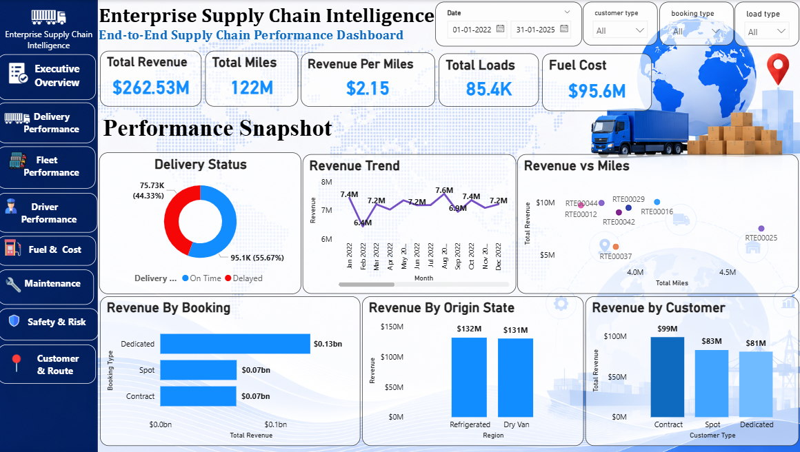
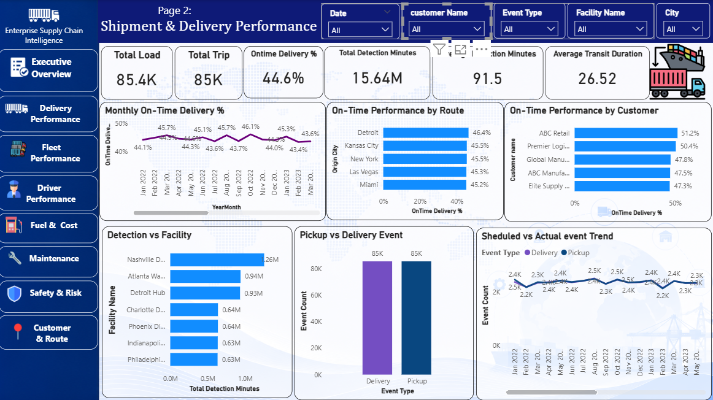
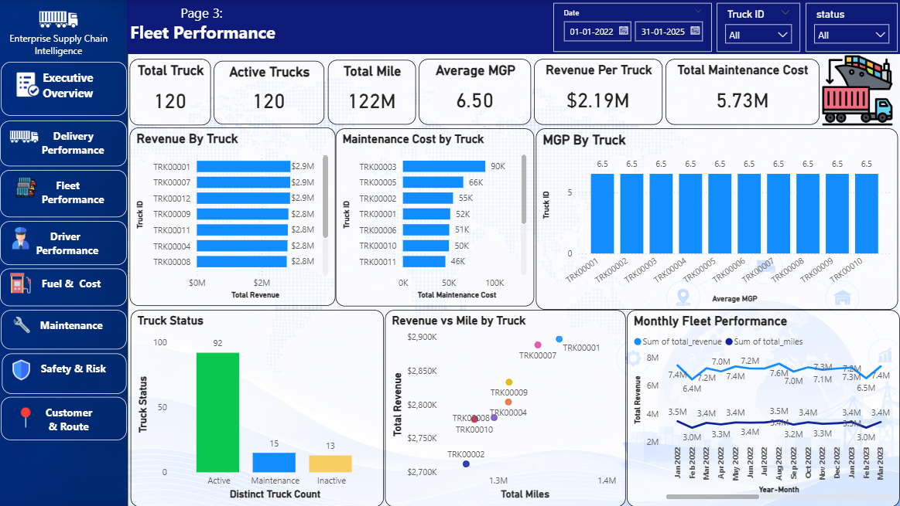
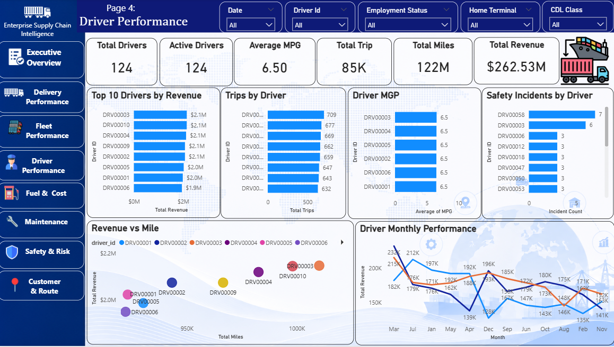
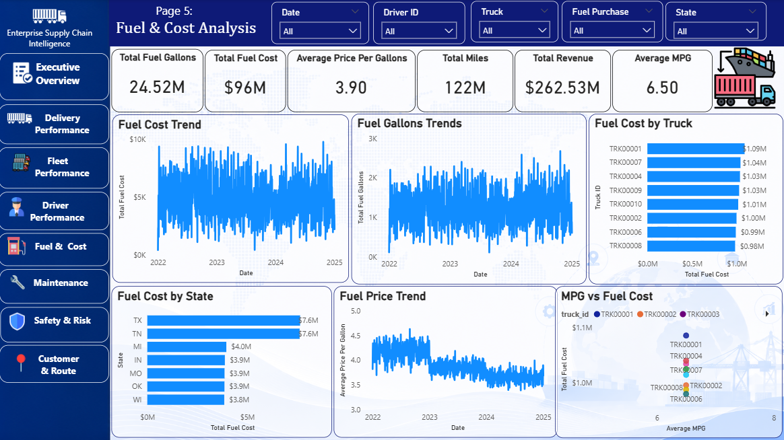
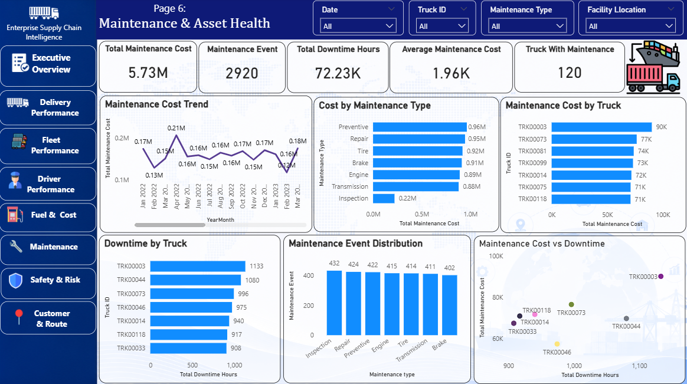
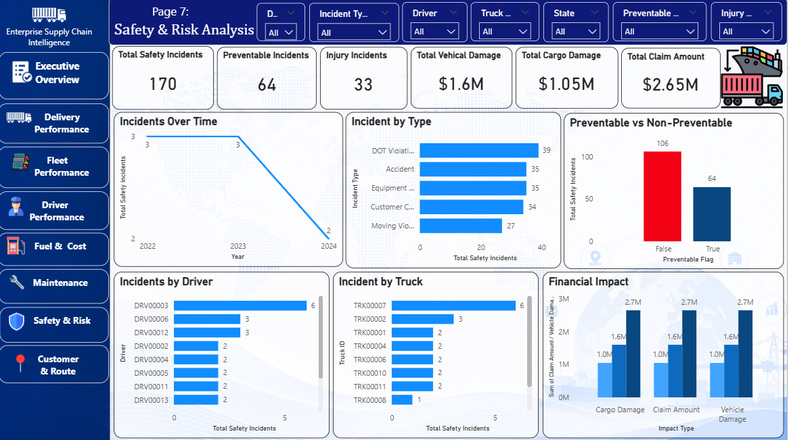
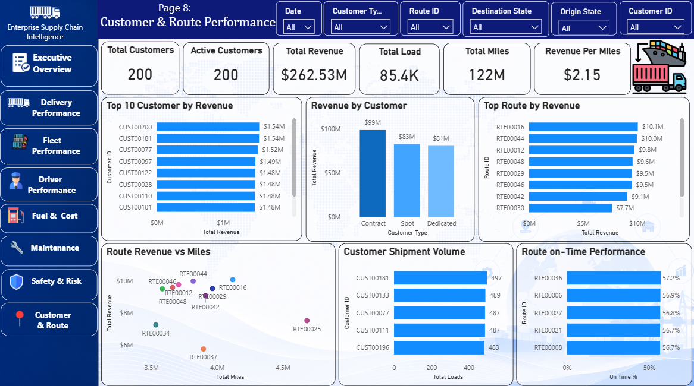

<h1 align="center">Enterprise Supply Chain Intelligence </h1>

<p align="center">


</p>

## Project Overview

**Enterprise Supply Chain Intelligence** is an industry-level **Power BI analytics project** designed to analyze logistics and fleet operations.

The project provides a centralized analytical solution for understanding:

* Logistics performance
* Revenue and shipment performance
* Delivery service levels
* Fleet utilization and efficiency
* Driver performance
* Fuel consumption and cost
* Maintenance and asset health
* Safety performance
* Customer and route performance

The project follows a complete Data Analyst workflow:

**EDA → Data Cleaning → Power Query → Data Modeling → DAX → Visualization → Business Insights**

---

## Project Objective

The main objective is to build an interactive Power BI dashboard that helps management and operations teams monitor operational performance, identify inefficiencies, and understand business trends across logistics and fleet operations.

---

## Tools & Technologies

* **Power BI**
* **DAX**
* **Power Query**
* **Excel**
* **Data Modeling**
* **Star Schema**
* **Exploratory Data Analysis (EDA)**

---

## Data Model

The project uses a **Star Schema / Dimensional Model**.

### Dimension Tables

* DimDate
* DimCustomer
* DimDriver
* DimTruck
* DimTrailer
* DimRoute
* DimFacility

### Fact Tables

* FactLoadTrip
* FactDeliveryEvent
* FactFuelPurchase
* FactMaintenance
* FactSafetyIncident

### Aggregate Fact Tables

* FactDriverMonthly
* FactTruckMonthly

The project maintains the correct grain of each business process rather than merging all fact tables into one large table.

## Dashboard Pages

### Page 1: Executive Logistic Overview

Identify highvolume/highrevenue and lowefficiency segments.

### Visualizations

* Revenue Trend
* Revenue by Load Type
* Revenue by Booking Type
* Revenue by Customer Type
* Revenue vs Miles

### KPIs

* Total Revenue
* Total Loads
* Total Trips
* Total Miles
* Revenue per Mile
* Total Fuel Cost

---

## Page 2: Shipment & Delivery Performance

Analyze Operational Shipment and Delivery Performance

### Visualizations

* Monthly OnTime Delivery %
* OnTime Performance by Route
* OnTime Performance by Customer
* Detention by Facility
* Pickup vs Delivery Events
* Scheduled vs Actual Event Trend

### KPIs

* Total Loads
* Total Trips
* OnTime Delivery %
* Total Detention Minutes
* Average Detention Minutes
* Average Transit Duration

---

## Page 3: Fleet Performance

Understand vehicle utilization, productivity and efficiency & Identify fleet utilization patterns.

### Visualizations

* Revenue by Truck
* Miles by Truck
* MPG by Truck
* Revenue vs Miles by Truck
* Monthly Fleet Performance

### KPIs

* Total Trucks
* Active Trucks 3. Total Miles
* Average MPG
* Revenue per Truck
* Total Truck Maintenance Cost

---

## Page 4: Driver Performance

Compare driver productivity, efficiency and operational performance.

### Visualizations

* Top Drivers by Revenue
* Trips by Driver
* Driver MPG
* Revenue vs Miles
* Safety Incidents by Driver
* Driver Monthly Performance

### KPIs

* Total Drivers
* Active Drivers
* Total Trips
* Total Miles
* Revenue
* Average MPG Visuals

---

## Page 5: Fual & Cost Analysis

Understand fuel consumption and operating cost.

### Visualizations

* Fuel Cost Trend
* Fuel Gallons Trend
* Fuel Cost by Truck
* Fuel Cost by State
* Fuel Price Trend
* MPG vs Fuel Cost

### KPIs

* Total Fuel Gallons
* Total Fuel Cost
* Average Price per Gallon
* Fuel Cost per Mile
* Average MPG
* Total Revenue

## PAGE 6: Maintenance & Asset Health

Understand maintenance expenditure, downtime and asset reliability.

### Visualizations

* Maintenance Cost Trend
* Cost by Maintenance Type
* Maintenance Cost by Truck
* Downtime by Truck
* Maintenance Event Distribution
* Maintenance Cost vs Downtime

### KPIs

* Total Maintenance Cost
* Maintenance Events
* Total Downtime Hours
* Average Maintenance Cost
* Total Trucks with Maintenance
* Average Downtime per Event
  
## PAGE 7: Safety & Risk Analysis

Understand operational safety and financial exposure.

### Visualizations

* Incidents Over Time
* Incidents by Type
* Preventable vs NonPreventable
* Incidents by Driver
* Incidents by Truck
* Financial Impact

### KPIs

* Total Safety Incidents
* Preventable Incidents
* Injury Incidents
* Total Vehicle Damage
* Total Cargo Damage
* Total Claim Amount

## PAGE 8: Customer & Route Performance

Identify the company's most valuable customers and best/worst performing routes.

### Visualizations

* Top 10 Customers by Revenue
* Revenue by Customer Type
* Top Routes by Revenue
* Route Revenue vs Miles
* Customer Shipment Volume
* Route OnTime Performance

### KPIs

* Total Customers
* Active Customers
* Total Revenue
* Total Loads
* Total Miles
* Revenue per Mile

### The Source Project Specification defines these as the 8 normal analytical pages, with optional drillthrough and tooltip pages not counted
### as dashboard pages. 

---

##  Key KPIs

### Core KPIs

* Total Revenue
* Total Loads
* Total Trips
* Total Miles
* Total Fuel Gallons
* Total Fuel Cost
* Total Maintenance Cost
* Total Maintenance Events
* Total Safety Incidents
* Total Detention Minutes

### Performance KPIs

* Revenue per Mile
* Revenue per Load
* Average MPG
* Fuel Cost per Mile
* Average Fuel Price
* Average Detention
* Average Maintenance Cost
* On-Time Delivery %

### Time Intelligence

* Revenue MTD
* Revenue YTD
* Previous Year Revenue
* Revenue YoY %
* Loads YTD
* Miles YTD

---

## Data Preparation

The data preparation workflow includes:

1. Data exploration
2. EDA
3. Missing-value analysis
4. Duplicate checking
5. Data-type validation
6. Data cleaning
7. Power Query transformations
8. Data modeling
9. Relationship creation
10. DAX measure development
11. Dashboard visualization
12. Business insight generation

---

##  DAX Measures

Reusable DAX measures are created for important KPIs.

Example:

```DAX
Total Revenue =
SUM(FactLoadTrip[Revenue])
```

```DAX
Total Loads =
COUNTROWS(FactLoadTrip)
```

```DAX
Total Miles =
SUM(FactLoadTrip[Miles])
```

```DAX
Revenue per Mile =
DIVIDE([Total Revenue], [Total Miles])
```

```DAX
Revenue per Load =
DIVIDE([Total Revenue], [Total Loads])
```

---

##  Business Insights

The dashboard is designed to identify data-supported insights related to:

* Revenue trends
* Shipment performance
* Delivery service levels
* Fleet utilization
* Driver productivity
* Fuel efficiency
* Maintenance expenditure
* Asset downtime
* Safety incidents
* Customer performance
* Route performance

Insights are generated from the underlying data rather than from unsupported assumptions.

---

## Advanced Power BI Features

The project includes/supports:

* Interactive slicers
* Drillthrough
* Custom report tooltips
* Dynamic titles
* Conditional formatting
* Time intelligence
* Page navigation

### Truck Detail Drillthrough

The Truck Detail page can display:

* Revenue
* Miles
* MPG
* Fuel Cost
* Maintenance Cost
* Downtime
* Safety Incidents
* Monthly Trend

## Project Structure

```text
Enterprise Supply Chain Intelligence/
│
├── 01_raw_data/
│   └── Enterprise_Supply_Chain_Dataset.xlsx
│
├── 02_powerbi_report/
│   └── Enterprise_Supply_Chain_Intelligence.pbix
│
├── 03_documentation/
│   └── Business_Requirements_&_Data_Dictionary.txt
│
├── aseets/
│   ├── Executive_Logistics_Overview.png
│   ├── Delivery_Performance.png
|   ├── Fleet_Performance.png
│   ├── Driver_Performance.png
│   ├── Fual_&_Cost_Performance.png
│   ├── Maintenance_&_Asset_Health.png
│   ├── Safety_&_Risk_Analysis.png
|   ├── Customer_&_Route_Performance.png
|   
└── README.md

```

## Dashboard Screenshots

### Executive Logistics Overview



### Delivery Performance



### Fleet Performance



### Driver Performance



### Fual & Cost Performance



### Maintenance & Asset Health



### Safety & Risk Analysis



### Customer & Route Performance



---

##  Skills Demonstrated

* Data Analysis
* Exploratory Data Analysis
* Data Cleaning
* Power Query
* Power BI
* DAX
* Data Modeling
* Star Schema
* KPI Development
* Dashboard Design
* Business Intelligence
* Business Insights

---

# Author

**Rohini Bhaje**

Email: **bhajerohini@gmail.com**

GitHub: **https://github.com/Rohinibhaje69-cloud**
